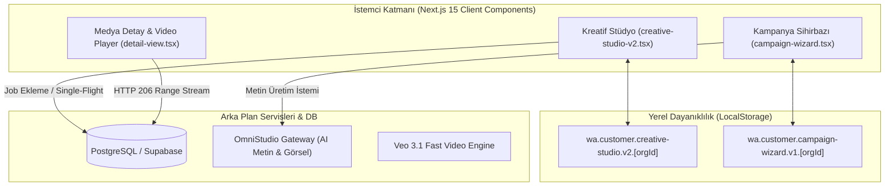

# TEST BASELINE VE SİSTEM MİMARİSİ
## Mesajify Wizard V3, Medya Motoru ve E2E Kabul Mimarisi

**Rapor Tarihi:** 11 Ekim 2026, 14:15 UTC+3  
**Çalışma Alanı (Worktree):** `C:\Users\TP2\Documents\whatsapp-codex-real-e2e-v2`  
**Branch:** `feat/codex-wizard-real-e2e-v2`  
**Referans Commit:** `a6e2fdb`  
**Test Çalıştırma Motoru:** Microsoft Edge (Playwright ile H.264/AAC demuxer lisanslı)  
**Yerel Panel:** `http://localhost:3025` (PID 5464)

---

## 1. Uçtan Uca Rota ve Bileşen Haritası

| Rota / Dosya | Tip | Görev / Sorumluluk | Durum Kaynağı (State Authority) |
|---|---|---|---|
| `/icerik` (`apps/customer/src/app/(panel)/icerik/page.tsx`) | Server Component | Tenant bazlı hazır ve denetim bekleyen medya varlıklarını listeler | PostgreSQL (`creatives`, `ai_media_jobs`, `ai_media_outputs`) |
| `/icerik/[id]` (`.../icerik/detail-view.tsx`) | Client Component | Görsel lightbox, HTML5 Video oynatıcı, Range 206 akışı ve onay arayüzü | Supabase DB + Event Watcher |
| `/icerik/yeni` (`.../icerik/creative-studio-v2.tsx`) | Client Component | 3 adımlı kreatif stüdyo sihirbazı (Görsel ve Video üretimi) | React state + LocalStorage draft (`wa.customer.creative-studio.v2.[orgId]`) |
| `/kampanyalar/yeni` (`.../kampanyalar/campaign-wizard.tsx`) | Client Component | 5 adımlı WhatsApp kampanya oluşturucu ve kütüphane handoff alıcısı | React Form Action State + LocalStorage draft |
| `/api/mesaj-yaz` (`.../api/mesaj-yaz/route.ts`) | Route Handler | OpenAI uyumlu OmniStudio ile metin üretimi, ton uyarlama ve ticari bütünlük denetimi | OmniStudio Gateway (`/v1/chat/completions`) + Local Gatekeeper |
| `/api/ai-media/jobs` (`.../api/ai-media/jobs/route.ts`) | Route Handler | Video prodüksiyon iş emri kaydı ve idempotent request kilidi | PostgreSQL (`ai_media_jobs`) |
| `/api/ai-media/outputs/[outputId]` | Route Handler | Yetkilendirilmiş video ve poster akışı (HTTP 206 Byte Range) | Hetzner S3 / Private Storage |

---

## 2. Durum Otoritesi ve Veri Akışı

1. **İdempotency ve Tekil Uçuş (Single-Flight) Kilidi:**
   - Ağ gecikmesi veya mükerrer tıklamalarda çift ücretli AI üretimini önlemek için `submissionLockRef` ve `submissionRequestKey` (UUID) kullanılır.
   - İstemci tarafında buton hemen `disabled` durumuna çekilir ve istek tamamlanana kadar kilitli kalır.

2. **Kütüphane -> Kampanya Handoff:**
   - `/icerik/[id]` sayfasından "Kampanyada kullan" tıklandığında `/kampanyalar/yeni?creative_id=[id]` rotasına yönlenir.
   - Kampanya sihirbazı parametreyi yakalar, görseli ve doğrulanmış ticari metni editöre bağlar.
   - Bağlantı kurulur kurulmaz `window.history.replaceState` ile URL temizlenir; böylece F5 yapıldığında sonsuz bağlama döngüsü engellenir.

3. **HTTP 206 Byte-Range Akışı:**
   - HTML5 video etiketinin akıcı scrub/seek yapabilmesi için sunucu `Range: bytes=start-end` başlığını destekler ve `206 Partial Content` döner.
